<div align="center">


# Smart Emailing

**Pelatihan interaktif menulis email lamaran kerja yang rapi, sopan, dan profesional untuk fresh graduate.**

Media pembelajaran berbasis web · Kelompok 7

[**Buka web**](https://akirasakamiyo.github.io/SmartEmailing/) · [Unduh versi offline](dist/SmartEmailing_Tim7_offline.html) · [Paket SCORM untuk LMS](dist/SmartEmailing_Tim7_SCORM.zip)

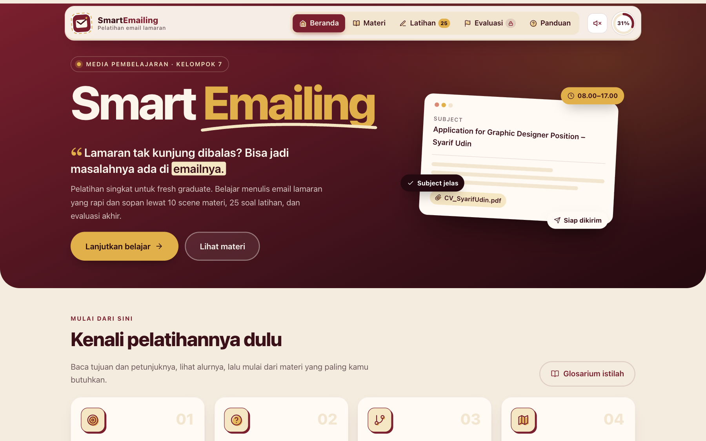

</div>

## Sekilas

Banyak lamaran kerja tidak dibalas bukan karena pelamarnya kurang mampu, tapi karena emailnya berantakan: subject tidak jelas, bahasa terlalu santai, lampiran lupa disebutkan, atau dikirim tengah malam. **Smart Emailing** mengajarkan cara menulis email lamaran yang benar lewat 13 scene singkat. Setiap scene punya penjelasan, narasi suara, dan aktivitas yang langsung bisa dicoba.

| | |
|---|---|
| **Sasaran** | Fresh graduate yang sedang bersiap melamar kerja |
| **Tujuan** | Peserta mampu merancang email lamaran kerja yang efektif, sesuai susunan dan etika komunikasi profesional |
| **Isi** | 3 materi · 10 scene materi · 25 soal latihan · 8 soal evaluasi · rangkuman |
| **Akses** | Online, offline (satu file HTML), atau di LMS (SCORM 1.2) tanpa internet dan tanpa akun |

## Alur belajar

```
Mulai → S01 Video pembuka
      → Materi 1: Dasar Komunikasi lewat Email      (S02 · S03 · S04)
      → Materi 2: Menulis Email Lamaran Kerja       (S05 · S06 · S07 · S08)
      → Materi 3: Etika Berkirim Email              (S09 · S10 · S11)
      → Latihan soal (L)
      → Semua materi selesai? → S12 Evaluasi → Nilai ≥ 75? → Ya: S13 Penutup
                                                           → Tidak: ulangi dari Materi 1
```

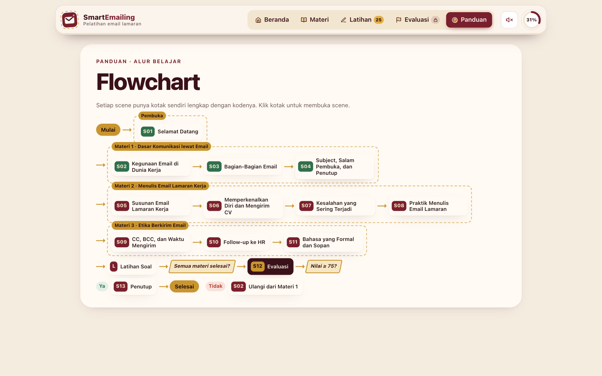

## Isi di dalam web

### 1. Beranda dan katalog materi
Beranda berisi pengenalan pelatihan, pintasan ke Tujuan, Petunjuk, Alur, dan Peta Konsep, tombol **Lanjutkan belajar** yang langsung membuka scene terakhir, serta progres per materi. Halaman **Materi** menampilkan ketiga materi beserta scene-nya. Scene yang sudah selesai diberi tanda centang, dan scene yang masih terkunci diberi gembok.

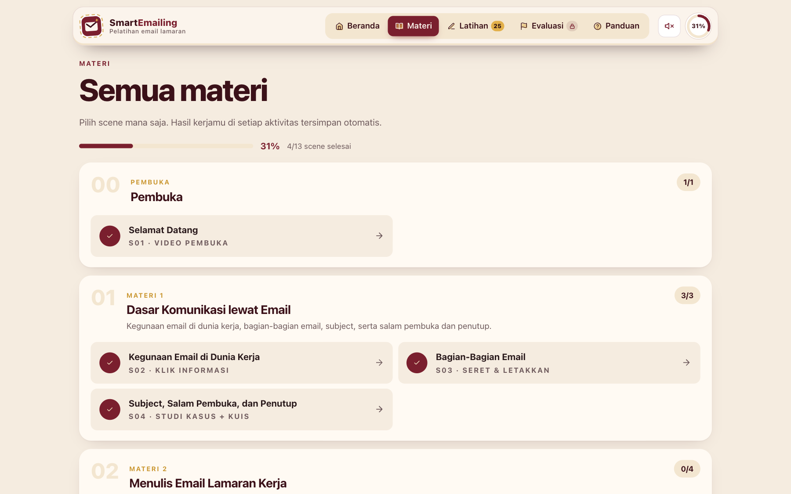

### 2. Halaman scene
Setiap scene ditampilkan seperti email masuk. Di atasnya ada **Rute Belajar**, deretan kode scene yang bisa diklik untuk berpindah scene. Isi setiap scene:
- **Tujuan** scene dalam bentuk catatan tempel
- **Narasi** yang bisa diputar sebagai suara, lengkap dengan teksnya
- **Materi** yang dibaca per kartu (Bagian 1, 2, …)
- **Aktivitas**. Tombol *Lanjut* baru aktif setelah aktivitasnya selesai.

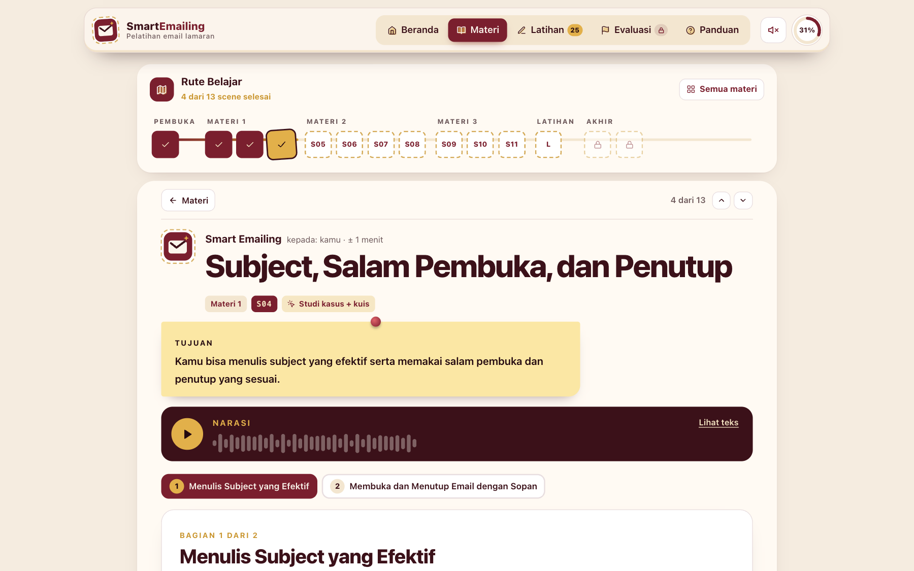

### 3. Aktivitas interaktif
Setiap scene memakai jenis aktivitas yang berbeda, dan semua jawaban tersimpan otomatis.

| Seret & letakkan (S03) | Temukan kesalahan (S07) |
|---|---|
| 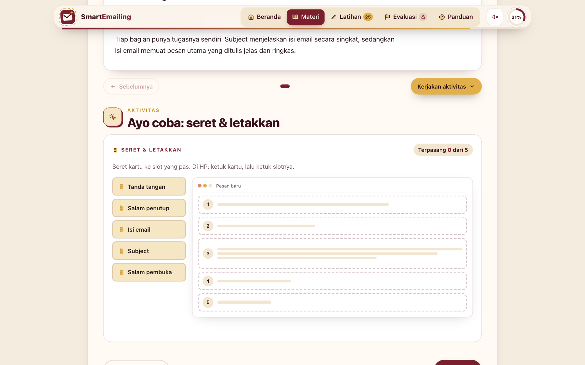 | 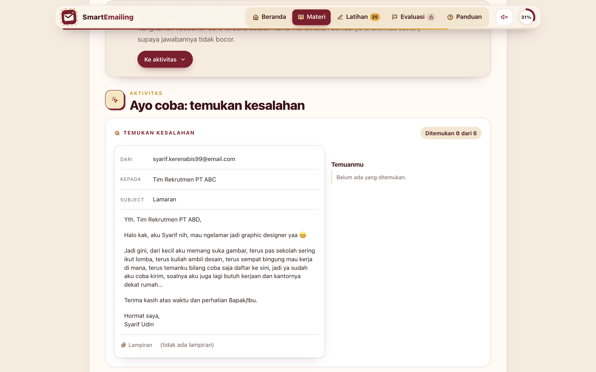 |

| Kode | Scene | Aktivitas |
|---|---|---|
| S01 | Selamat Datang | Video pembuka (animasi + narasi) |
| S02 | Kegunaan Email di Dunia Kerja | Klik informasi |
| S03 | Bagian-Bagian Email | Seret & letakkan |
| S04 | Subject, Salam Pembuka, dan Penutup | Studi kasus + kuis |
| S05 | Susunan Email Lamaran Kerja | Klik bagian email |
| S06 | Memperkenalkan Diri dan Mengirim CV | Simulasi menulis email |
| S07 | Kesalahan yang Sering Terjadi | Temukan 6 kesalahan |
| S08 | Praktik Menulis Email Lamaran | Form + daftar periksa + contoh jawaban |
| S09 | CC, BCC, dan Waktu Mengirim | Animasi + atur jam + kuis |
| S10 | Follow-up ke HR | Pilih langkahmu |
| S11 | Bahasa yang Formal dan Sopan | Pilih kalimat yang tepat |

### 4. Latihan soal
Ada **25 soal campuran**: pilihan ganda, benar/salah, memasangkan, mengurutkan, dan mengelompokkan. Setiap jawaban langsung diperiksa dan disertai pembahasan. Nomor soal berwarna hijau untuk jawaban benar dan merah untuk yang belum tepat, dan soal bisa dikerjakan ulang kapan saja.

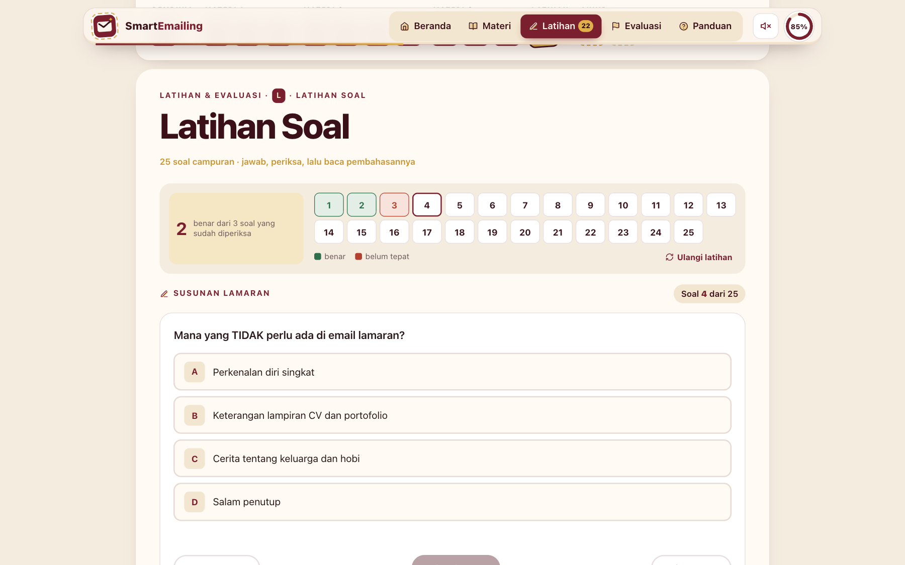

### 5. Evaluasi akhir (S12)
- **Terkunci** sampai semua scene materi selesai.
- Berisi **8 soal tanpa pilihan ganda** yang diambil dari jenis aktivitas di materi: urutkan, pasangkan, kelompokkan, tandai kesalahan, dan atur jam kirim.
- Selama mengerjakan **tidak ada tanda benar/salah**. Jawaban tersimpan otomatis, dan setiap soal yang sudah dijawab ditandai cap.
- Sebelum dikirim, peserta bisa memeriksa lembar jawabannya. **Nilai akhir** baru muncul setelah semua jawaban dikirim, dengan batas lulus **75**.

| Mengerjakan evaluasi | Hasil evaluasi |
|---|---|
| 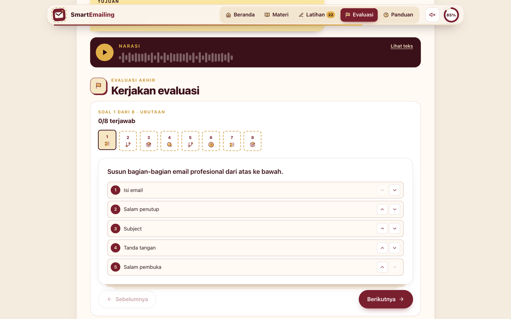 | 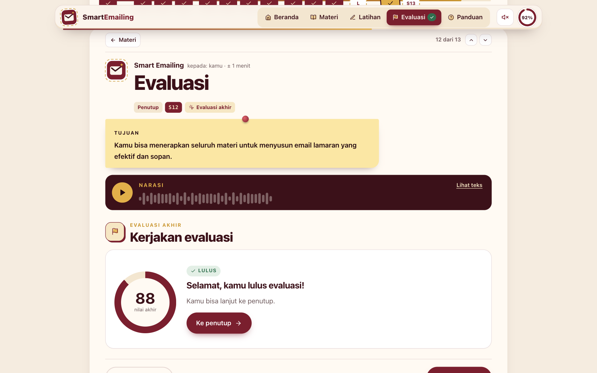 |

### 6. Penutup (S13)
Terbuka setelah peserta lulus evaluasi. Isinya rangkuman satu halaman yang bisa disimpan sebagai PDF, ditambah formulir masukan (rating bintang dan saran).

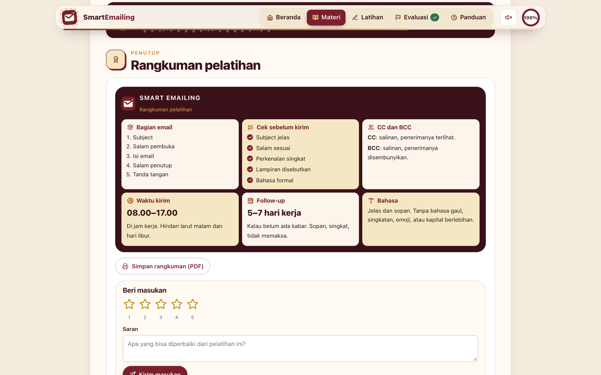

### 7. Tampilan di HP
Di HP, semua halaman tampil layar penuh dengan menu di bagian bawah. Seret & letakkan diganti dengan *ketuk kartu, lalu ketuk slotnya*.

<p align="center">
  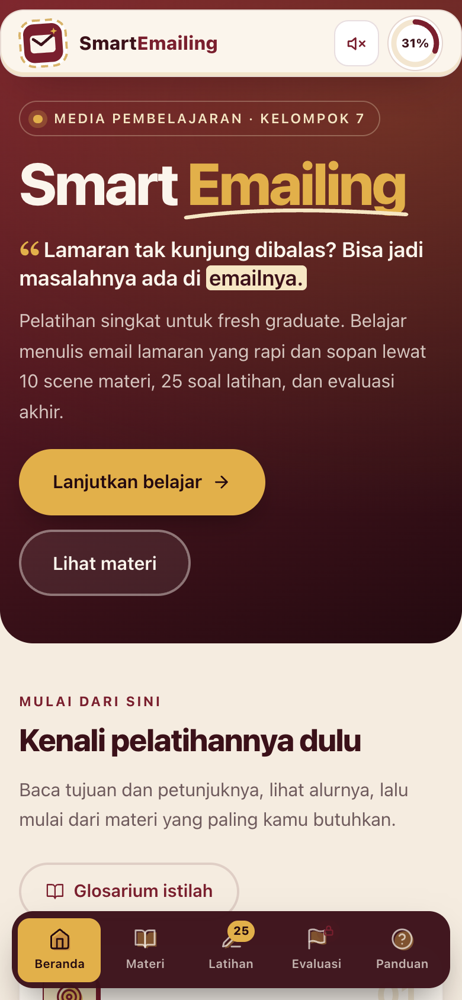
  &nbsp;&nbsp;
  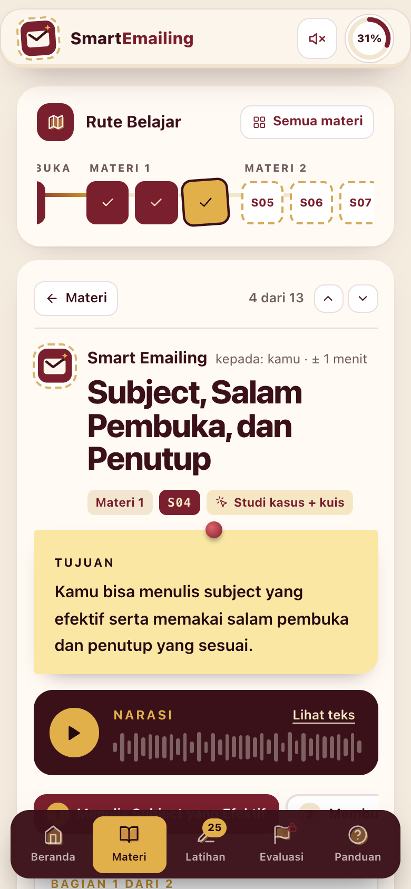
</p>

## Fitur lain
- **Progres tersimpan otomatis** di browser: scene selesai, jawaban setiap aktivitas, latihan, dan evaluasi. Pindah halaman tidak menghapus apa pun.
- **Cincin progres dan badge** di navbar: persentase belajar, jumlah soal latihan yang belum dikerjakan, dan status evaluasi.
- **Panduan**: Tujuan belajar per scene, Petunjuk dan arti kode interaksi (*Normal, Hover, Hit, Swipe, Seret & letakkan, Show*), Flowchart, Peta Konsep, dan Glosarium yang bisa dicari.
- **Animasi dan suara**: transisi berbeda untuk setiap jenis halaman, ikon yang bergerak saat diklik, efek suara benar/salah (bisa dimatikan), dan konfeti saat scene selesai.
- **Tanpa tautan luar**: semua aset ada di dalam web, jadi bisa dipakai tanpa internet.
- **Warna**: marun, krem, dan emas.

## Cara memakai

| Cara | Langkah |
|---|---|
| **Online** | Buka https://akirasakamiyo.github.io/SmartEmailing/ |
| **Offline** | Unduh `dist/SmartEmailing_Tim7_offline.html`, lalu klik dua kali. Tidak butuh internet. |
| **LMS (Moodle, dll.)** | Unggah `dist/SmartEmailing_Tim7_SCORM.zip` sebagai aktivitas SCORM (*Add an activity → SCORM package*). Status belajar dan nilai evaluasi otomatis tercatat di LMS, dan peserta dinyatakan lulus bila nilainya ≥ 75. |
| **Folder web** | `dist/SmartEmailing_Tim7.zip` untuk aktivitas *Folder* / *IMS content*. |

## Untuk tim: cara update web
Setelah mengedit file, pilih salah satu cara:
1. Klik dua kali **`Update ke GitHub.command`** di Finder. Paket offline, ZIP, dan SCORM dibuat ulang, lalu diunggah.
2. Klik dua kali **`Sinkron Otomatis.command`** dan biarkan jendelanya terbuka. Setiap file yang disimpan otomatis diunggah 10 detik kemudian.
3. Lewat Terminal: `./tools/publish.sh "pesan perubahan"`.

GitHub Pages memperbarui web sekitar 1–2 menit setelah unggahan.

<details>
<summary><b>Struktur folder</b></summary>

```
SmartEmailing_Tim7/
├── index.html          ← halaman utama (dipakai GitHub Pages)
├── css/styles.css      ← tampilan (marun · krem · emas)
├── js/app.js           ← isi materi, scene, aktivitas, latihan, evaluasi
├── assets/img/         ← logo dan favicon
├── docs/screenshots/   ← foto tampilan untuk README ini
├── tools/build.py      ← membuat paket offline, ZIP, dan SCORM di dist/
├── tools/publish.sh    ← build + commit + unggah ke GitHub
├── tools/autosync.py   ← unggah otomatis setiap file disimpan
├── Update ke GitHub.command / Sinkron Otomatis.command ← klik dua kali di Finder
├── CHECKLIST_AUDIT_INTERNAL.md
└── dist/               ← paket siap kirim (offline .html, .zip, SCORM .zip)
```
</details>

---
<sub>Smart Emailing · Kelompok 7 · Materi seluruhnya disusun dari dokumen desain tim.</sub>
